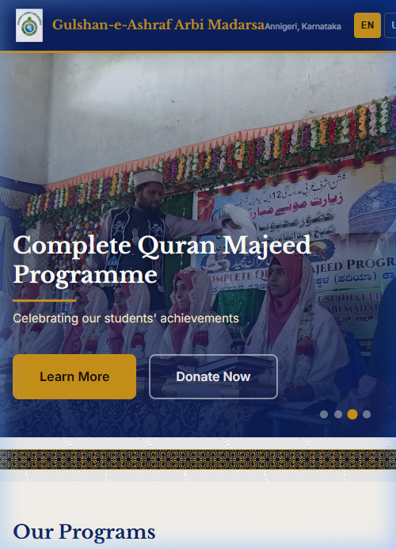
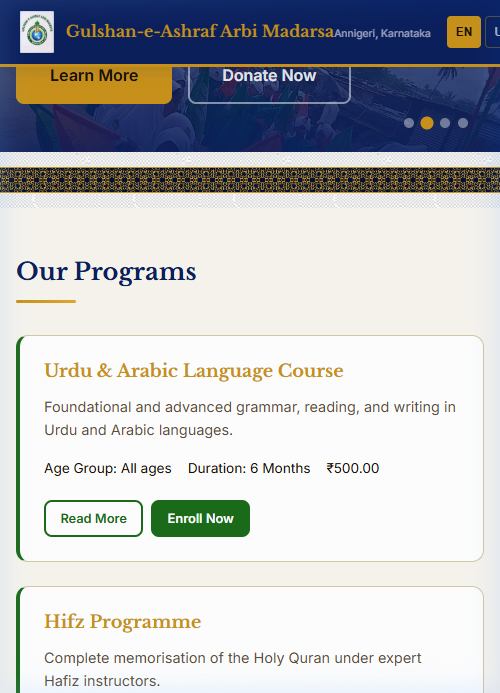
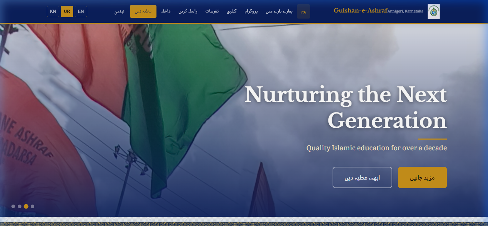
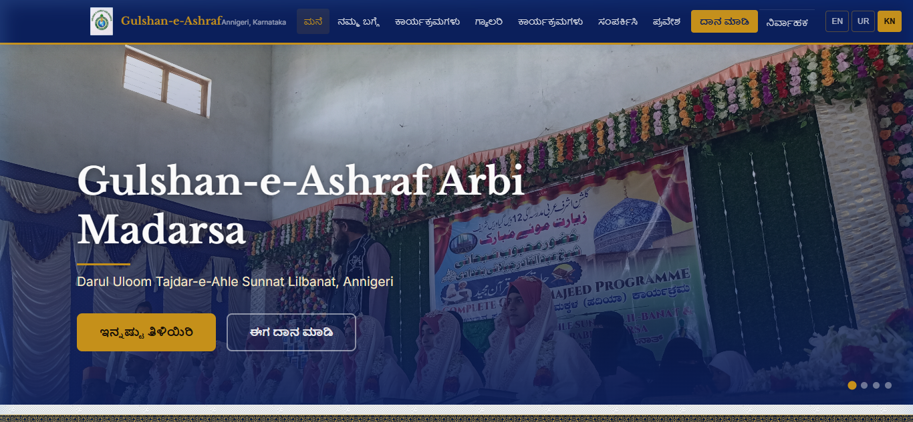
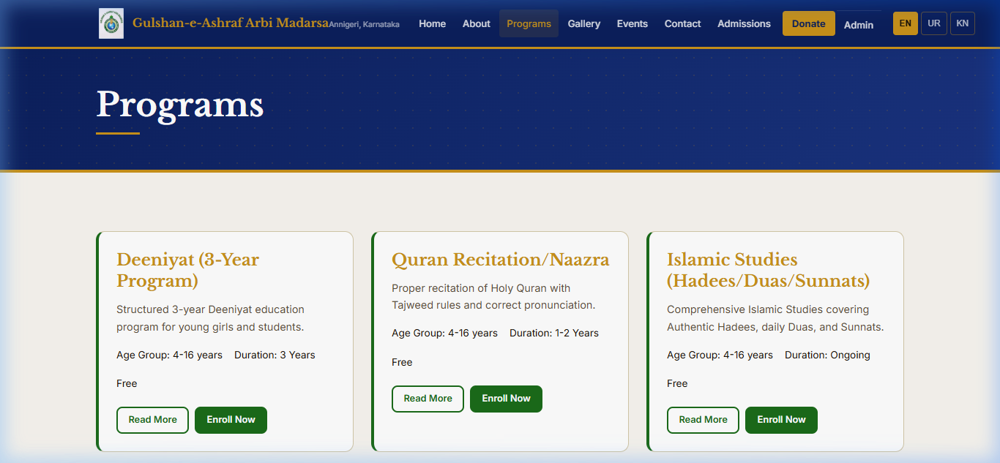
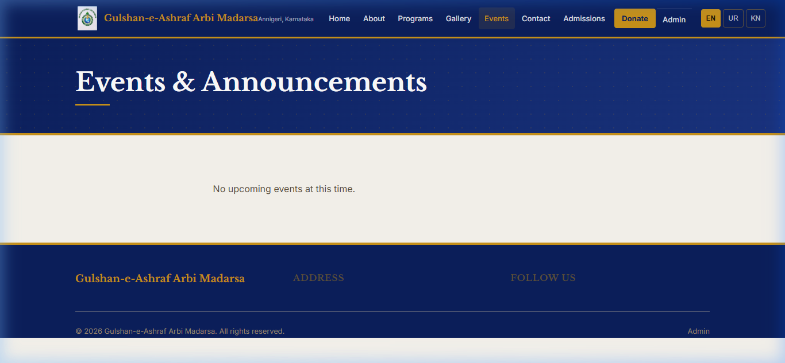
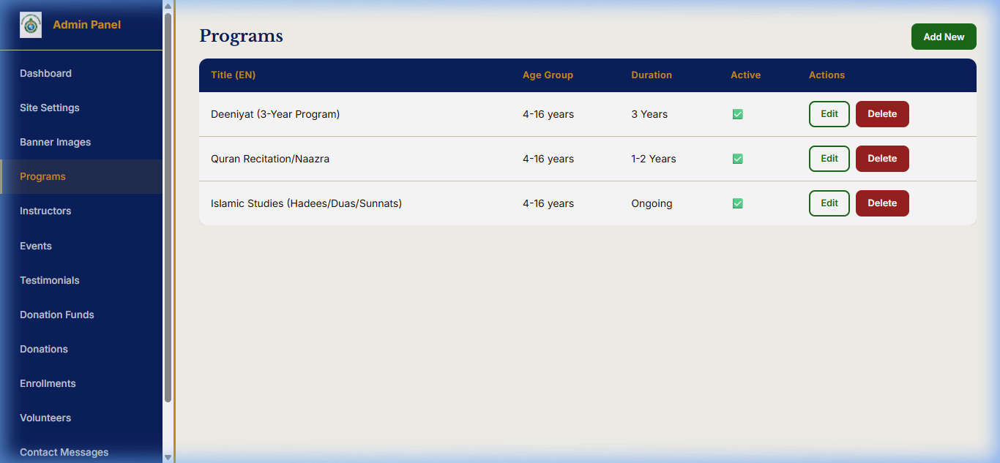
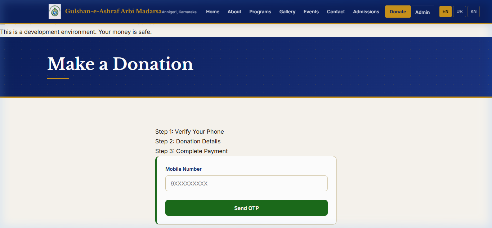

# 🕌 Gulshan-e-Ashraf Arbi Madarsa

> **Darul Uloom Tajdar-e-Ahle Sunnat Lilbanat** — Annigeri, Karnataka  
> A state-of-the-art, full-stack educational and institutional portal built for modern web standards, trilingual accessibility, and seamless administration.

[](https://react.dev/)
[](https://vitejs.dev/)
[](https://www.djangoproject.com/)
[](https://www.django-rest-framework.org/)
[](LICENSE)

---

## 🌟 Project Overview & Current State

The **Gulshan-e-Ashraf Arbi Madarsa** web platform is a production-grade web application engineered to represent the institution, facilitate student admissions, manage educational programs, accept online donations (Zakat/Sadqah), and display community events & announcements.

### 📌 Current Status: **Production Ready & Verified**
- **System Integrity**: All 11 Django backend apps and DRF APIs pass validation with 0 issues (`python manage.py check`).
- **Frontend Build**: Vite client bundle compiles cleanly with 0 build errors (`npm run build`).
- **Data Architecture**: Powered by a centralized `PublicDataProvider` context layer that caches public resources in memory, preventing duplicate network requests and eliminating HTTP 429 rate limits.
- **Seeded Data**: Pre-seeded with authentic client programs (**Islamic Studies**, **Quran Recitation/Naazra**, **Deeniyat 3-Year Program**) with **Free Khidmat** (`fee=null`), and an empty Events table ready for real staff publishing.

---

## 📸 Visual Showcase

### 🏠 Public Homepage
Hero carousel featuring high-resolution institution imagery, geometric Islamic architectural dividers, and responsive program cards.




---

### 🌐 Trilingual & RTL Support
Supports **English**, **Urdu** (with full right-to-left layout flipping and native *Noto Nastaliq Urdu* calligraphic typography), and **Kannada** (`ಕನ್ನಡ ಲಿپی`).

| Urdu (RTL Calligraphic View) | Kannada (LTR Regional View) |
| :---: | :---: |
|  |  |

---

### 📚 Academic Programs & Events
Detailed view pages for institution offerings and community event image galleries.

| Programs Overview | Events & Announcements |
| :---: | :---: |
|  |  |

---

### 🛡️ Single-Page Admin Dashboard & OTP Auth
Config-driven single CRUD component (`CrudPage.jsx`) powering administrative management for all 6 resources, secured with phone + OTP passwordless authentication.

| Admin Dashboard (Programs CRUD) | Passwordless Phone OTP Login |
| :---: | :---: |
|  |  |

---

## ✨ Key Features & Architectural Highlights

### 1. 🌐 Trilingual Localization & Native RTL Engine
- **Languages Supported**: English (`en`), Urdu (`ur`), Kannada (`kn`).
- Dynamic `dir="rtl"` attribute switching when switching to Urdu.
- Trilingual database fields (`title_en`, `title_ur`, `title_kn`, `description_en`, etc.) fallback gracefully if a translation is pending.

### 2. ⚡ Shared Data Layer (`PublicDataProvider`)
- Single React Context layer (`frontend/src/context/PublicDataContext.jsx`) fetches public endpoints **once** and caches them in memory.
- All components (`Navbar`, `Footer`, `Home`, `Events`) consume cached data, eliminating duplicate network fetches and guaranteeing smooth performance under heavy traffic.

### 3. 🔐 Phone + OTP Passwordless Authentication
- Eliminates traditional email/password vulnerabilities.
- Admin staff log in via registered 10-digit Indian mobile numbers and 6-digit OTP verification.
- Extensible SMS gateway integration (Console logger for dev; MSG91 ready for production).

### 4. 💳 Razorpay Online Donations & Hard-Gated Mock Guard
- Donors select specific funds (General, Zakat, Infrastructure) and verify via phone OTP prior to payment.
- **Production Guard**: `config/settings/prod.py` enforces a hard gate that raises `ImproperlyConfigured` if `RAZORPAY_MOCK_MODE=True` is enabled when `DEBUG=False`.

### 5. 🛠️ Generic Config-Driven Admin CRUD (`CrudPage.jsx`)
- Single reusable React component drives CRUD operations for:
  - **Programs** (Academic courses)
  - **Instructors** (Faculty profiles)
  - **Events & Event Images** (Multi-photo galleries per event)
  - **Testimonials** (Parent & student reviews)
  - **Donation Funds** (Targeted donation categories)
  - **Banner Images** (Homepage hero slides)

---

## 🛠️ Technology Stack

### **Frontend**
- **Core**: React 18, React Router v6
- **Build Tool**: Vite 8.3
- **Styling**: Vanilla CSS3 with CSS Custom Properties (Design System tokens), micro-animations, and responsive flex/grid layouts.
- **Typography**: Google Fonts (*Outfit* for English, *Noto Nastaliq Urdu* for Urdu script).
- **HTTP Client**: Axios with JWT Bearer request/response interceptors.

### **Backend**
- **Framework**: Django 5.0 + Django REST Framework 3.14
- **Authentication**: SimpleJWT (JWT Bearer Tokens) + Custom OTP Engine
- **Database**: SQLite (Development) / PostgreSQL-ready (Production)
- **Image Processing**: Pillow (Django `ImageField`)
- **Security**: Django CorsHeaders, rate limiting (`AnonRateThrottle`, `UserRateThrottle`, `OTPSendThrottle`), HSTS, Content-Type NoSniff.

---

## 📁 Repository Structure

```
madarsa-project/
├── backend/
│   ├── apps/
│   │   ├── accounts/       # User model, PhoneOTP, SimpleJWT auth
│   │   ├── contact/        # Public contact form & admin list
│   │   ├── core/           # SiteSettings (singleton), BannerImages
│   │   ├── donations/      # DonationFund, Donation, Razorpay integration
│   │   ├── enrollments/    # Student admissions applications
│   │   ├── events/         # Event model & multi-photo EventImage gallery
│   │   ├── gallery/        # Photo albums & nested gallery items
│   │   ├── instructors/    # Faculty profiles & bios
│   │   ├── programs/       # Trilingual course offerings
│   │   ├── testimonials/   # Reviews & quotes
│   │   └── volunteers/     # Community volunteer signups
│   ├── config/
│   │   ├── settings/       # base.py, dev.py, prod.py (Hard-gated security)
│   │   ├── urls.py         # Versioned API route dispatcher (/api/v1/)
│   │   └── wsgi.py
│   └── manage.py
├── frontend/
│   ├── public/
│   │   ├── images/         # Institutional photography
│   │   └── logo-source.png # Brand logo asset
│   ├── src/
│   │   ├── admin/          # AdminLayout, AdminLogin, AdminSettings, CrudPage
│   │   ├── api/            # Axios client instance
│   │   ├── components/     # Navbar, Footer, HeroCarousel, ProgramCard, etc.
│   │   ├── context/        # PublicDataContext (Shared in-memory cache)
│   │   ├── hooks/          # Custom hooks (usePrograms, useEvents, etc.)
│   │   ├── i18n/           # English, Urdu, Kannada translation JSONs
│   │   ├── pages/          # Home, About, Programs, Events, Gallery, Donate, Contact
│   │   ├── App.jsx         # Router & provider setup
│   │   └── index.css       # Full Design System stylesheet
│   └── index.html
├── docs/
│   └── images/             # Documentation screenshots
└── README.md
```

---

## 🚀 Getting Started

### Prerequisites
- **Python**: 3.10 or higher
- **Node.js**: 18.0 or higher
- **Package Managers**: `pip` and `npm`

---

### 1. Backend Setup

```bash
# 1. Navigate to the backend directory
cd backend

# 2. Create and activate a virtual environment
python -m venv venv
# On Windows:
venv\Scripts\activate
# On macOS/Linux:
source venv/bin/activate

# 3. Install dependencies
pip install django djangorestframework djangorestframework-simplejwt django-cors-headers django-filter django-environ pillow razorpay

# 4. Run database migrations
python manage.py migrate

# 5. Create an initial admin user (phone number based)
python manage.py shell -c "
from apps.accounts.models import User
User.objects.create_superuser(phone='9999999999', password='adminpassword')
"

# 6. Start the Django development server
python manage.py runserver
```
The Django REST API will be available at `http://127.0.0.1:8000/api/v1/`.

---

### 2. Frontend Setup

```bash
# 1. Navigate to the frontend directory
cd frontend

# 2. Install NPM dependencies
npm install

# 3. Start the Vite development server
npm run dev
```
The application will open at `http://localhost:5173/`.

---

## 🔗 Main API Endpoints Summary

| Endpoint | Method | Access | Description |
| :--- | :---: | :---: | :--- |
| `/api/v1/site-settings/` | `GET` | Public | Singleton institution settings, name, tagline, founder info |
| `/api/v1/programs/` | `GET` | Public | Active academic programs list (supports `is_active` filter) |
| `/api/v1/events/` | `GET` | Public | Published events list with nested photo gallery images |
| `/api/v1/gallery/` | `GET` | Public | Photo albums with nested gallery items |
| `/api/v1/testimonials/` | `GET` | Public | Approved parent & student testimonials |
| `/api/v1/donations/status/` | `GET` | Public | Razorpay status & mock mode state |
| `/api/v1/auth/otp/send/` | `POST` | Public | Send 6-digit OTP (Purpose: `admin` or `donor`) |
| `/api/v1/auth/otp/verify/` | `POST` | Public | Verify OTP & receive JWT token / donor token |
| `/api/v1/admin/programs/` | `CRUD` | Admin | Full CRUD management for academic programs |
| `/api/v1/admin/events/` | `CRUD` | Admin | Full CRUD management for events and announcements |
| `/api/v1/admin/event-images/` | `CRUD` | Admin | Multi-photo upload and management per event |

---

## 📜 License & Acknowledgments

- **Institution**: Gulshan-e-Ashraf Arbi Madarsa (Darul Uloom Tajdar-e-Ahle Sunnat Lilbanat, Annigeri, Karnataka).
- **License**: Released under the [MIT License](LICENSE).
